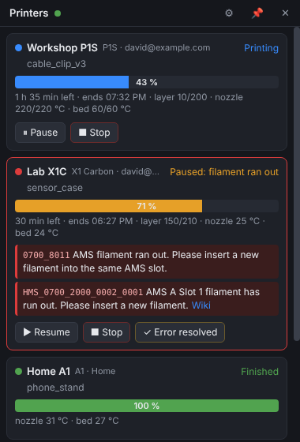
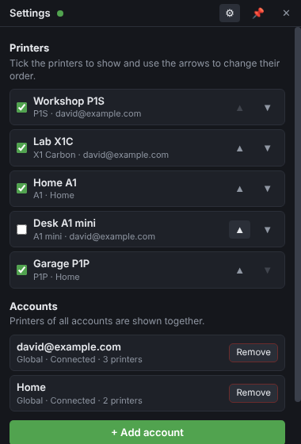
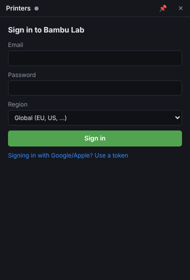
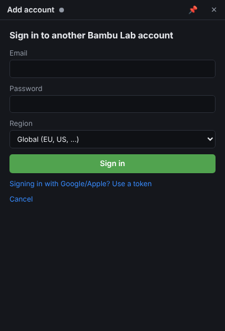
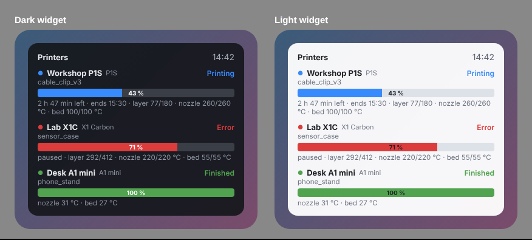
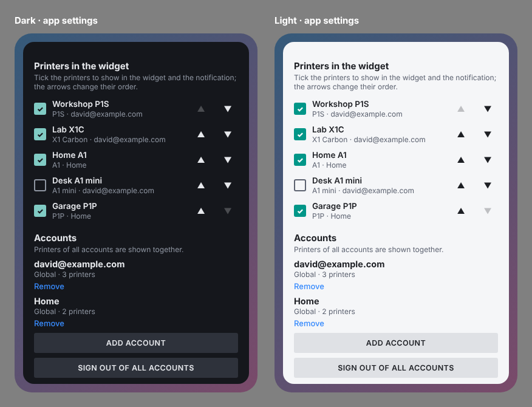
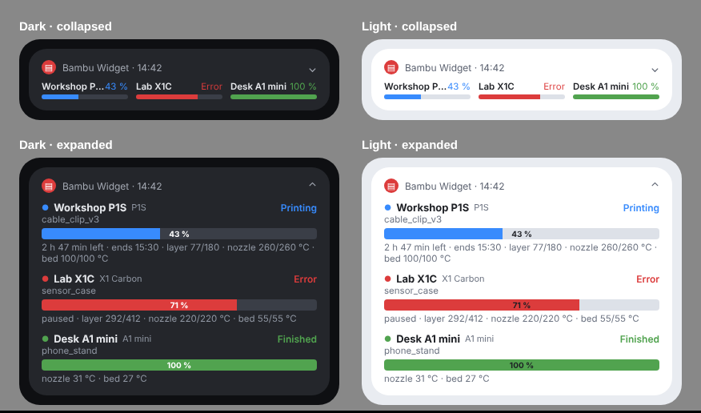

# Bambu Widget

Status widgets for **Bambu Lab 3D printers** on **Windows** and **Android**. Both apps sign in to one or more Bambu Lab
accounts and read every printer bound to them through **Bambu Cloud**, so the printers do not have to be on the same
network as your computer or phone.

| Windows | Android |
|---|---|
| Desktop widget with tray icon, notifications and print controls | Home screen widget and optional status bar notification |
| Choose which printers to show and in which order | Choose which printers to show and in which order |
| Several Bambu Lab accounts at once | Several Bambu Lab accounts at once |

**Download:** [latest release](https://github.com/davidkompan/bambuwidget/releases/latest) (`BambuWidget-windows.zip`, `BambuWidget-android.apk`).

## Screenshots

### Windows

Printers of two accounts in one widget, and the Settings screen (⚙) where you choose which printers to show, their
order and the signed-in accounts. Screenshots of the app running with demo data.

| Widget | Settings |
|---|---|
|  |  |
| **Sign in** | **Add account** |
|  |  |

### Android

Home screen widget, status bar notification and the new printer and account settings, in dark and light mode.

> The Android images are design renders made with demo data; layouts on real phones differ slightly by manufacturer.

## Features

### Windows
* One card per printer: state, job name, colour coded progress bar, time left, finish time, layer, nozzle and bed temperatures.
* Print errors and HMS messages with their code, description and a link to the Bambu wiki.
* Windows notifications when a print fails, pauses, finishes or reports a new error.
* Pause, Resume, Stop (confirmed with a second click) and Error resolved buttons. See *Limitations*.
* Tray icon coloured by the worst state of all printers; always on top and start with Windows options.
* **Settings** (⚙ in the title bar or *Settings…* in the tray menu): tick the printers to show and move them up or down.
* **Several accounts**: *Add account* signs in to another Bambu Lab account; printers of all accounts are shown together,
  with the account name next to the model. Each account can be removed on its own.

### Android
* Home screen widget, resizable, one block per printer with a colour coded progress bar
  (blue printing, amber paused, green finished, red **Error**, grey idle / offline).
* **Error** only when a fault stopped or paused the print (failed job, filament run out, nozzle clog, …);
  warnings that do not interrupt the print are ignored.
* Optional permanent status bar notification: all printers in one row when collapsed, one block per printer when expanded.
* Update interval from *only when tapped* to every 2, 5, 15, 30 or 60 minutes, with an explanation of the battery
  impact of each option and a shortcut to the battery optimization setting.
* Appearance: System, Dark or Light. Read only, no controls.
* **Printers in the widget**: tick the printers to show in the widget and the notification, change their order with the arrows.
* **Several accounts**: *Add account* in the Accounts section; printers of all accounts are shown together. If one
  account's sign-in expires, its last known state stays visible until you sign in again.

## Install

Download the files from the [Releases](https://github.com/davidkompan/bambuwidget/releases/latest) page.

### Windows
1. Download `BambuWidget-windows.zip` and extract it.
2. Run `install.bat`. It installs Node.js through winget if needed, copies the app to `%LOCALAPPDATA%\BambuWidget`,
   downloads Electron (about 100 MB) and creates *Bambu Widget* shortcuts on the desktop and in the Start menu.
3. Start the widget from the shortcut and sign in. Running `install.bat` again updates an existing installation;
   version 1.0 sign-ins and settings are kept.

### Android (6.0 and newer)
1. Download `BambuWidget-android.apk` on the phone and open it; allow installing apps from that source when asked.
2. Open **Bambu Widget**, sign in, choose the update interval.
3. Long-press the home screen › Widgets › **Bambu Widget**. Tap the widget to update it now.

If Android refuses to install a new version over the old one ("App not installed" or "package conflicts"), the new APK
is signed with a different key: uninstall Bambu Widget first, then install the new APK and sign in again.

## Signing in

Sign in with your Bambu Lab email and password. To watch printers of more accounts, add them in the settings
(*Add account*); every account signs in the same way. If Bambu asks for it, enter the code sent by email or the code from
your authenticator app. Choose *China* only for accounts on bambulab.cn.

**Accounts that use Google or Apple sign-in** use a token instead:

1. On a computer, open Chrome or Edge and sign in at [bambulab.com](https://bambulab.com).
2. Press **F12**, open the **Application** tab (Firefox: **Storage**).
3. Expand **Cookies**, select `https://bambulab.com` and copy the value of the cookie named **token**.
4. Paste it in the app (*Use a token* / *Sign in with a token instead*).

Keep the token private: it gives access to your Bambu account until it expires (about 3 months).

**Privacy.** The password is only sent to Bambu Lab during sign-in and is never stored. The apps keep only the access
token: on Windows encrypted with the system key store (Electron `safeStorage`), on Android in the app's private storage.
Nothing is sent anywhere except Bambu Lab's own servers.

## Limitations

* **Control on new firmware.** Bambu Lab's *Authorization Control* firmware (2025) accepts control commands only when
  they are signed by Bambu Lab software. Such printers reject Pause, Resume, Stop and Error resolved from this app;
  the Windows widget then switches that printer to read-only and points to Bambu Handy / Bambu Studio.
  Reading the status keeps working. [Bambu Lab announcement](https://blog.bambulab.com/firmware-update-introducing-new-authorization-control-system-2/)
* **No camera.** The camera stream is only available on the local network.
* **Android updates.** Bambu Cloud has no push service for third-party apps, so the Android app polls. Android allows
  battery friendly background work at most every 15 minutes; shorter intervals use alarms that wake the phone and are
  stretched to about 10 minutes while the phone sleeps.
* Unofficial: uses the same cloud API as Bambu Studio and OrcaSlicer, which Bambu Lab may change at any time.

## Repository layout

| Folder | Contents |
|---|---|
| `windows/` | Electron app (JavaScript), installer scripts |
| `android/` | Android app (Java, no Gradle), build script |
| `docs/images/` | Screenshots |
| `.github/workflows/release.yml` | Builds the APK and the Windows zip and publishes a release when a `v*` tag is pushed |

### Building

* **Windows:** `cd windows && npm install && npx electron .`
* **Android:** see [android/README.md](android/README.md).
* **Release:** push a tag such as `v1.1.0`; the workflow attaches both files to the release, with the notes from
  `docs/release-notes/<tag>.md`. To sign the APK with your own key, add the repository secrets
  `ANDROID_KEYSTORE_BASE64` (`base64 -w0 release.keystore`) and `ANDROID_KEYSTORE_PASSWORD`.

## Credits

Sign-in flow based on [bambu-taskbar](https://github.com/Dawn-Of-Justice/bambu-taskbar), error texts and wiki links
from [ha-bambulab](https://github.com/greghesp/ha-bambulab); details in [THIRD_PARTY_NOTICES.md](THIRD_PARTY_NOTICES.md).
Not affiliated with or endorsed by Bambu Lab.

## License

[MIT](LICENSE). Third-party components keep their own licenses, see [THIRD_PARTY_NOTICES.md](THIRD_PARTY_NOTICES.md).
